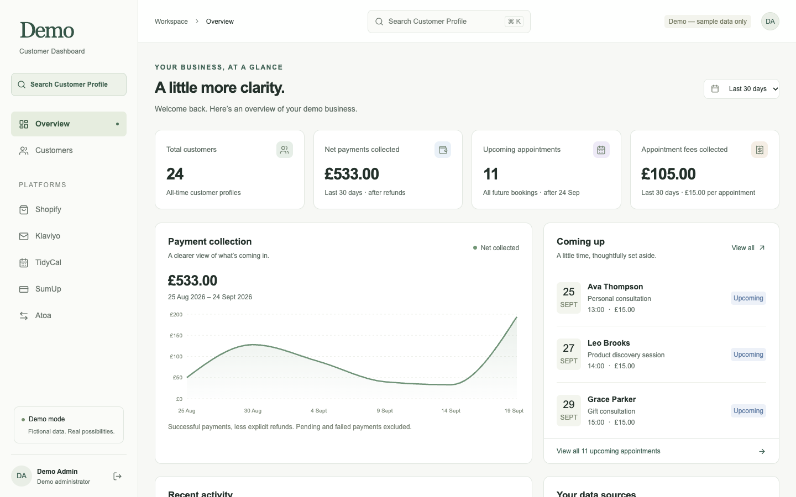

<div align="center">

# Unified Customer Operations Dashboard

### Five platforms. One typed, testable customer view.

[](https://nextjs.org/)
[](https://www.typescriptlang.org/)
[](https://react.dev/)
[](https://playwright.dev/)
[](https://demo-admin-dashboard-dun.vercel.app/)

[Live Demo](https://demo-admin-dashboard-dun.vercel.app/) · [Source Code](https://github.com/adityajaiswal1724/demo-admin-dashboard) · [Report an Issue](https://github.com/adityajaiswal1724/demo-admin-dashboard/issues)

</div>



## Why this project exists

Customer activity is usually fragmented across commerce, marketing, scheduling, and payment tools. This project explores how those records can be normalised into one calm, searchable operations interface without sacrificing traceability.

It is a frontend-only portfolio demo with deterministic fictional data. No external platform accounts, real customer records, backend, or database are connected.

## Demo access

| Username | Password |
| --- | --- |
| `admin` | `admin@1234` |

The login is an intentional presentation gate implemented in `sessionStorage`—not production authentication. The password is never persisted.

## Core capabilities

- Executive overview with ledger-derived KPIs and payment trends
- Global customer search by name, email, phone, or customer ID
- Sortable and paginated customer directory powered by TanStack Table
- Unified profiles for purchases, appointments, payments, and communications
- Dedicated Shopify, Klaviyo, TidyCal, SumUp, and Atoa views
- Read-only record drawers, campaign previews, filters, and empty states
- Keyboard-first navigation with `Cmd/Ctrl + K`
- Responsive layouts, reduced-motion support, visible focus states, and accessible dialogs

## Technical architecture

```text
Typed deterministic fixtures
          │
          ▼
Shared data and ledger services ───► Search / filtering / reconciliation
          │
          ▼
Next.js App Router pages ──────────► Tables / charts / record drawers
          │
          ▼
Static export on Vercel
```

| Area | Implementation |
| --- | --- |
| Framework | Next.js 16 App Router, React 19 |
| Language | TypeScript 5 |
| UI system | Tailwind CSS 4, Radix primitives, class-variance-authority |
| Data UI | TanStack Table, Recharts |
| Quality | ESLint, TypeScript, Node test runner, Playwright |
| Hosting | Static export on Vercel |

## Data model and correctness

The fixture layer contains 24 customers, 48 orders, 36 appointments, 84 payments, 6 campaigns, and 60 communications. Relationships are deterministic and validated by tests.

- Currency is stored as integer pence and formatted as GBP.
- Successful payments contribute to collected totals.
- Explicit refunds are subtracted on their recorded dates.
- Pending and failed payments contribute zero.
- Order values remain separate from collected payments to prevent double counting.
- Booking status and payment status are modelled independently.
- Dates use a fixed reference date and the `Europe/London` timezone.

## Run locally

Requires Node.js 22.9 or newer.

```bash
git clone https://github.com/adityajaiswal1724/demo-admin-dashboard.git
cd demo-admin-dashboard
npm ci
npm run dev
```

Open [http://localhost:3000](http://localhost:3000).

## Quality gates

```bash
npm run typecheck
npm run lint
npm test
npm run build
npm run preview
npm run test:e2e
```

The end-to-end suite covers authentication flow, protected routes, keyboard search, customer profiles, sorting, pagination, filters, record drawers, external-link safety, and responsive behaviour.

## Deployment

`next.config.ts` exports the application as static HTML, CSS, and JavaScript. `vercel.json` installs with `npm ci`, runs the production build, and serves `out/`. No environment variables are required.

## Scope boundary

This repository demonstrates interface architecture and data modelling. The named platforms are represented by prepared sample records only—there is no live syncing, transaction processing, message sending, booking, analytics tracking, or identity matching.

---

<div align="center">
Designed as a rigorous portfolio case study, not a production admin system.
</div>
